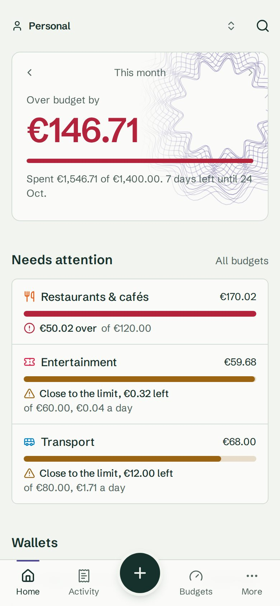
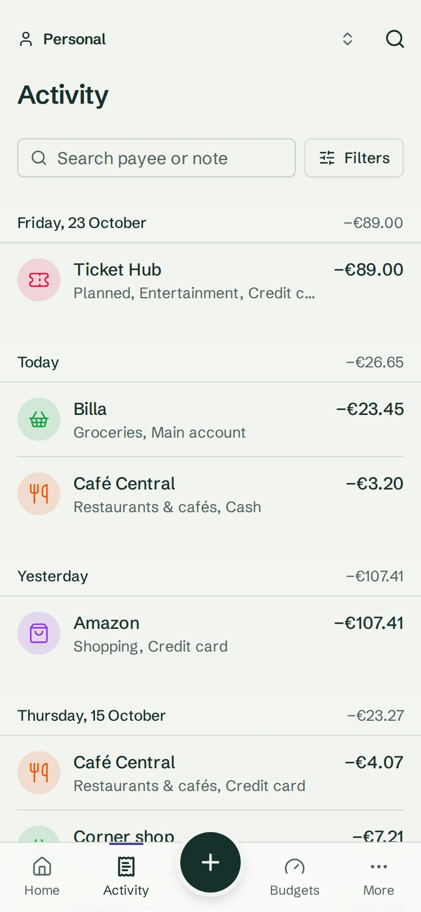
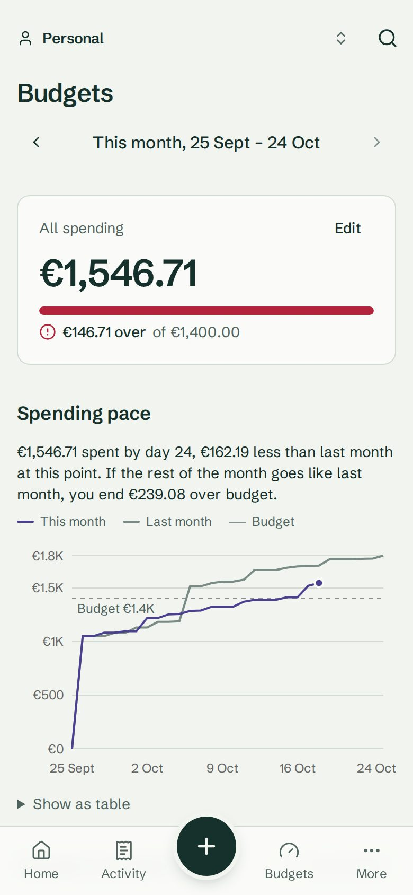
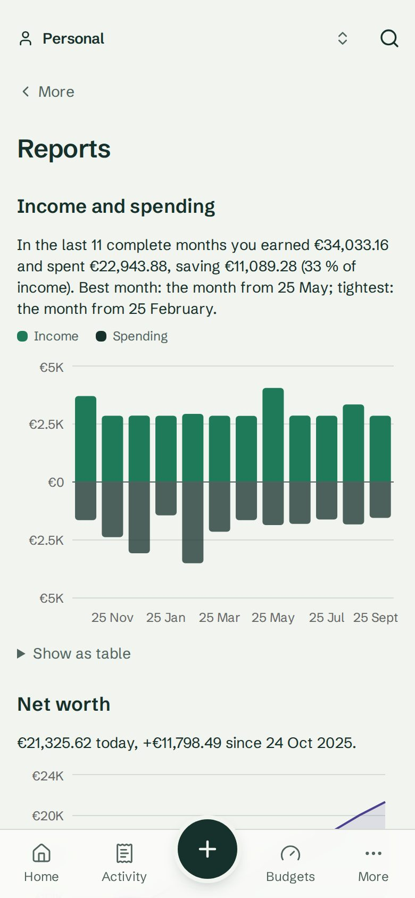
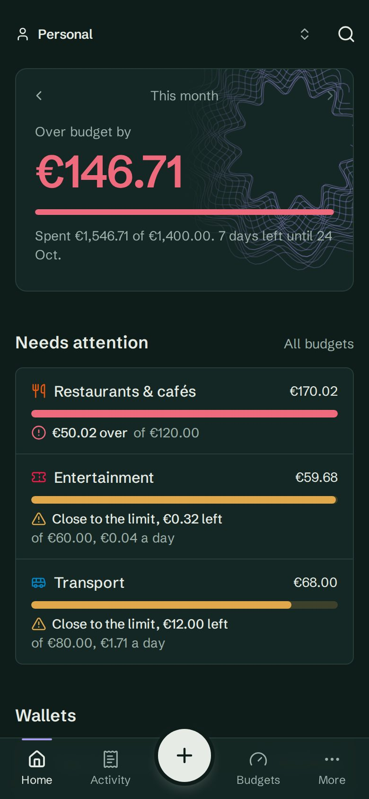

# BudgetMaster

[](https://github.com/AkosKappel/BudgetMaster/actions/workflows/ci.yml)
[](LICENSE)

Author: **Ákos Kappel**

A mobile-first personal finance app: record income and expenses in seconds, see where the money went, and know how much is left this month. Alone or shared with a partner. A rebuild from scratch of the original Next.js and MongoDB version.

**Live:** https://budgetmaster.tailb52c43.ts.net. **Try the demo** there for a private copy of 14 months of sample data, no sign-up needed.

| Home                               | Activity                                   | Budgets                                  | Reports                                  | Dark mode                                            |
| ---------------------------------- | ------------------------------------------ | ---------------------------------------- | ---------------------------------------- | ---------------------------------------------------- |
|  |  |  |  |  |

## Features

- **Capture:** quick add in a few seconds, or typed as one line like `coffee 3.20 cash yesterday`, with payee memory, sums like `12+4.50` in amount fields, receipts split across categories, receipt photos (optionally read by Claude to fill in the form), recurring payments that record themselves on their due date, and CSV import of bank statements with duplicate checks, review, remembered column layouts per bank and undo of a whole import.
- **Understand:** activity grouped by day with search and filters kept in the URL, reports with income and spending per month, net worth, a spending calendar, a 90-day balance forecast, a printable monthly report, a year in review, how prices at regular payees changed in a year, and "worth a look" hints on Home (possible double charges, pricier subscriptions, a category on the rise).
- **Plan:** a monthly budget and limits per category, a budget month that can start on payday, a spending pace chart, warnings and payments due this week on Home, unspent budget carried into the next month, savings goals, and subscriptions spotted in what you enter by hand.
- **Organise:** wallets in their own currencies, categories with subcategories (merge or delete duplicates), tags; the command palette finds all of them.
- **Share:** spaces for a household with emailed invites, owner, editor and viewer roles, "paid by" with balances and settling up, live updates on every member's device, and a log of who changed what, with restore for deleted transactions and undo for changes.
- **Sign-in security:** email confirmation, password reset, optional Google, GitHub, Apple and Microsoft sign-in, passkeys, two-step sign-in with an authenticator app and backup codes, and a list of signed-in devices to sign out.
- **Own your data:** export everything as JSON or CSV and delete your account; no third-party tracking.
- **Feels like an app:** installable PWA with an offline page and pull to refresh, light and dark mode from every page, a Settings page (theme, first day of the week, security, data), command palette (Ctrl+K), keyboard shortcuts, swipe to delete with undo, tabs that stay in sync.

## Tech stack

- [TanStack Start](https://tanstack.com/start) (React 19, file-based routing, server functions) on Vite and Nitro
- TypeScript
- [TanStack Query](https://tanstack.com/query) for server state, [Zustand](https://zustand.docs.pmnd.rs/) for client state, TanStack Form, Hotkeys and Pacer
- [shadcn/ui](https://ui.shadcn.com/) on Tailwind CSS 4, Recharts for charts
- [Motion](https://motion.dev/) (formerly Framer Motion) for animations
- PostgreSQL 18 with [Drizzle ORM](https://orm.drizzle.team/)
- [Better Auth](https://www.better-auth.com/) for authentication
- [Biome](https://biomejs.dev/) for linting and formatting, Playwright with axe for end-to-end tests

## How it fits together

- **Routes** in `src/routes/`: public pages at the top level, the signed-in app under `_app/`. Loaders prefetch with TanStack Query, so pages render on the server with their data.
- **Server functions** in `src/server/`: every one takes the space id, checks membership and role (`requireMembership`) and validates its input with Zod. Modules that only export helpers for them (`membership.ts`, `movement.ts`, `wallet-balances.ts`, `recurring-due.ts`) are never imported by client code, so the database driver stays out of the browser bundle.
- **Money** is stored as integers in minor units; totals and budgets are summed in SQL. "Today" follows the user's time zone (`src/lib/today.ts`).
- **Security:** a nonce-based Content Security Policy, CSRF checks for server functions, security headers and request logging in `src/start.ts`; rate-limited sign-in through Better Auth, with the limits kept in the database.
- **Deployment:** a Docker image built in CI and pulled on the server, run from its own folder (`deploy/`), never from this checkout; a maintenance page, a restore test for backups and a post-deploy smoke test (`scripts/smoke.ts`).

## Getting started

Requires Node 24, pnpm and Docker.

```bash
pnpm install
cp .env.example .env   # then set DB_PASSWORD, DATABASE_URL and BETTER_AUTH_SECRET
docker compose up -d   # PostgreSQL on 127.0.0.1:5436
pnpm db:migrate
pnpm db:seed       # optional demo data
pnpm dev
```

The app runs on http://localhost:3000.

## Scripts

| Command            | Description                            |
| ------------------ | -------------------------------------- |
| `pnpm dev`         | Start the dev server                   |
| `pnpm build`       | Production build into `.output/`       |
| `pnpm preview`     | Preview the production build           |
| `pnpm typecheck`   | Type-check with `tsc`                  |
| `pnpm lint`        | Lint with Biome                        |
| `pnpm format`      | Format with Biome                      |
| `pnpm check`       | Lint, format and import order check    |
| `pnpm check:fix`   | Apply all safe Biome fixes             |
| `pnpm db:generate` | Create a migration from schema changes |
| `pnpm db:migrate`  | Apply pending migrations               |
| `pnpm db:studio`   | Open Drizzle Studio                    |
| `pnpm db:seed`     | Recreate the demo users and their data |
| `pnpm test`        | Run unit tests (`node --test`)         |
| `pnpm test:e2e`    | Run Playwright tests (build first)     |

## Demo data

**Try the demo** on the sign-in page gives every visitor a private anonymous account with about 14 months of sample data (Better Auth `anonymous` plugin). Signing up keeps the data; otherwise it is deleted after 48 hours. The generator lives in `src/db/demo-data.ts`.

For development, `pnpm db:seed` also recreates three shared logins (listed on the sign-in page in dev only), all with the password `demo-budget-2026`:
- `demo@budgetmaster.app`: about 14 months of personal data and owner of a shared Household space
- `jordan@budgetmaster.app`: small personal space, member of Household
- `empty@budgetmaster.app`: no data, for empty states

The script checks its own data (balances, budget states) and fails if a check does not hold.

## UI components

Add shadcn/ui components with:

```bash
pnpm dlx shadcn@latest add <component>
```

## Database

The schema lives in `src/db/schema/`, migrations in `drizzle/`. The auth tables (`auth.ts`) are generated by Better Auth. Regenerate them after changing the auth config:

```bash
pnpm dlx auth@latest generate --config src/lib/auth.ts --output src/db/schema/auth.ts --yes
```

## Docker

The `Dockerfile` builds a production image: the Nitro server bundle on Node 24, running as a non-root user with a health check on `/api/health`. CI builds it for every pull request and pushes `ghcr.io/akoskappel/budgetmaster` on `main`. Migrations run as a one-off container from the same image before the app starts:

```bash
docker run --rm --env-file .env <image> node scripts/migrate.ts
```

The app needs `DATABASE_URL`, `BETTER_AUTH_SECRET` and `BETTER_AUTH_URL`. Production runs from its own folder with the files in [`deploy/`](deploy/README.md).

## Testing

- Unit tests (`pnpm test`) cover money parsing, recurrence, CSV and import parsing, filters.
- End-to-end tests (`pnpm build && pnpm test:e2e`) run against the production build on a desktop and a phone profile. Each test starts its own private demo, so they need a migrated database but no seed data. They cover the main flows and run axe accessibility checks on every page, in light and dark mode.
- CI also checks Lighthouse budgets on the public pages and scans the Docker image for vulnerabilities.

## License

[MIT](LICENSE)
